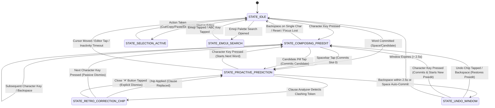

# Lekhani Android: Complete System Specification & Operational Contract
**Document Version**: 2.0.0  
**Target Platform**: Android 8.0+ (API 26 to API 35+)  
**Architecture**: Three-Tier (Pure Rust Engine ↔ UniFFI Bridge ↔ Kotlin Jetpack Compose/Hardware Canvas)  
**Classification**: Engineering Truth & System Specification

---

## 1. Executive Principles & Non-Negotiable Directives

Every line of code across Lekhani must adhere to these inviolable architectural laws:

1. **Absolute Privacy (Zero Telemetry)**:
   - The application **must never** transmit keystrokes, clipboard snippets, audio streams, or user typing frequencies off the device.
   - All language models (N-gram, BPE neural GRU, Avro trie, morphological DAG) and ASR engines execute **100% locally on-device**.
   - `android.permission.INTERNET` is strictly forbidden from core IME operations and analytics. Crashlytics, Firebase, and telemetry libraries are barred from the repository.

2. **Sub-Millisecond & Zero-Allocation Hot Path Budget**:
   - Keystroke latency (touch-down to hardware canvas draw): **< 3 ms**.
   - Canvas render loop: Sustained **120 FPS** (frame budget: < 8.3 ms).
   - **Zero heap allocations** inside the touch loop: `onDraw()`, `onTouchEvent()`, or native `process_key()`. All `Paint`, `RectF`, `Path`, and `Matrix` objects must be pre-allocated during initialization or layout bounds change.
   - Native Rust candidate ranking & Anvaya agreement: **< 100 µs** hot-path latency.

3. **Canonical Unicode & Script Integrity**:
   - Text committed to Android `InputConnection` must always be canonical Unicode (NFC).
   - Never corrupt Bengali grapheme clusters, conjuncts (`ক্ষ`, `জ্ঞ`, etc.), or modifier diacritics.

4. **Slot 0 WYSIWYG Invariant (Never Override User Intent on Space)**:
   - **Spacebar always commits exactly what is highlighted in Slot 0.**
   - Suggestion engines (such as Anvaya honorific agreement) **must never hijack Slot 0** or force-substitute words on Spacebar tap.
   - Verbatim typed transliteration sits in Slot 0; concordant suggestions sit in Slot 1.

5. **Professional Material 3 Expressive UI & Strict Vector Iconography**:
   - **Never use unicode emojis as icons, pseudo-icons, category chips, or decorative decorations** in buttons, chips, tabs, headers, banners, dialogs, notices, or settings UI.
   - All visual iconography must strictly use official Android/Material 3 vector icons (`ImageVector`, `Icons.Filled.*`, `Icons.Outlined.*`) or hardware-rendered vector drawables.
   - Unicode emojis are strictly reserved for user-typed text inputs (the emoji picker palette, `EmojiData`, kaomoji picker).

---

## 2. Three-Tier System Architecture

```
┌────────────────────────────────────────────────────────────────────────┐
│               TIER 3: Android Native Layer (Kotlin 2.0)                │
│  - LekhaniInputMethodService (IME Lifecycle, InputConnection, IPC)    │
│  - KeyboardCanvasView (Hardware Canvas 120 FPS Bivariate Key Grid)     │
│  - CandidateStripView (Jetpack Compose Pill Strip & Floating Actions) │
│  - Settings & Theme Studio (Material 3 Expressive, DPS Store)          │
└───────────────────────────────────▲────────────────────────────────────┘
                                    │ UniFFI Auto-Generated C-ABI Bindings
┌───────────────────────────────────▼────────────────────────────────────┐
│               TIER 2: Native FFI Bridge (Rust / cargo-ndk)             │
│  - crates/lekhani-android (C-ABI scaffolding via uniffi)               │
│  - AndroidLekhaniSession (Thread-safe lifecycle & preedit coordinator) │
│  - RetroDampener (Bayesian noise filter for retro-correction chips)    │
│  - AudioRecord Streaming Buffer (Offline Vosk/Sherpa ASR)              │
└───────────────────────────────────▲────────────────────────────────────┘
                                    │ Direct Rust Crate Dependencies
┌───────────────────────────────────▼────────────────────────────────────┐
│               TIER 1: Upstream Engine Crates (Pure Rust)               │
│  - lekhani-core: Headless IME state machine & layout managers          │
│  - lekhani-parser: 11 ns/char Avro Trie grammar & transliteration      │
│  - lekhani-ai: 4-gram statistical LM, Anvaya agreement, Dhvani-Setu   │
│  - lekhani-neural: 32-D word embeddings, context-adaptive GRU alpha    │
└────────────────────────────────────────────────────────────────────────┘
```

---

## 3. The Formal IME State Machine

The Android IME layer operates under a deterministic finite-state machine (FSM). At any millisecond, the keyboard is in exactly one of these states:



### State Definitions & Invariants

| State | Composing Buffer | Candidate Strip Display | Spacebar Behavior |
| :--- | :--- | :--- | :--- |
| **`STATE_IDLE`** | Empty | Empty or QuickClipboard chip | Inserts raw `' '` into editor |
| **`STATE_COMPOSING_PREEDIT`** | Non-empty | Multi-track Candidate Pills (Slots 0..5) | Commits Slot 0 verbatim + appends `' '` |
| **`STATE_PROACTIVE_PREDICTION`** | Empty | Next-word predictive completions | Inserts raw `' '` into editor |
| **`STATE_RETRO_CORRECTION_CHIP`** | Empty | Single contextual fix pill (`original` ➔ `replacement`) | Inserts raw `' '` and passive-dismisses chip |
| **`STATE_UNDO_WINDOW`** | Empty | Single `[ Revert to '...' ]` pill | Inserts raw `' '` and closes undo window |
| **`STATE_SELECTION_ACTIVE`** | Empty | Selection Toolbar (`Cut`, `Copy`, `Paste`, `Select All`) | Overwrites selection with `' '` |
| **`STATE_EMOJI_SEARCH`** | Query string | Live matching emoji palette | Inserts `' '` into emoji search query |

---

## 4. Keystroke & Gesture Truth Table (Arbitration Matrix)

This matrix defines the definitive system behavior for every input event across all operational states:

| Input Event | `STATE_IDLE` | `STATE_COMPOSING_PREEDIT` | `STATE_PROACTIVE_PREDICTION` | `STATE_RETRO_CORRECTION_CHIP` | `STATE_UNDO_WINDOW` |
| :--- | :--- | :--- | :--- | :--- | :--- |
| **Letter / Key Token** | Enters `COMPOSING`; sets preedit shadow; queries candidates. | Appends token to buffer; updates preedit; ranks candidates. | Commits current position; starts new `COMPOSING` word. | Records passive chip dismissal ($w=-0.2$); starts new `COMPOSING`. | Closes undo window; starts new `COMPOSING`. |
| **Spacebar (Single Tap)** | Commits raw space `' '` to active editor. | Commits Slot 0 verbatim candidate; appends `' '`; enters `PROACTIVE_PREDICTION`. | Commits raw space `' '`; triggers next-word prediction query. | Dismisses chip passively ($w=-0.2$); inserts raw space. | Closes undo window; inserts raw space. |
| **Spacebar (Double Tap < 450ms)** | Replaces space with `। ` (Bengali) or `. ` (English). | Commits Slot 0, then evaluates double-tap punctuation. | Replaces preceding space with `। ` or `. `. | Replaces preceding space with `। ` or `. `. | Replaces preceding space with `। ` or `. `. |
| **Spacebar (Long Press)** | Opens Layout Switcher dialog sheet. | Bypasses AI reranking; commits pure rule-based Avro candidate (`commitForceAvro`). | Opens Layout Switcher dialog sheet. | Opens Layout Switcher dialog sheet. | Opens Layout Switcher dialog sheet. |
| **Backspace (Tap)** | Sends `KeyEvent.KEYCODE_DEL` to target editor. | Deletes last character in composing buffer; updates candidates. | If within 2.5s of space auto-commit, restores previous preedit (`UNDO`). | Dismisses retro-chip; deletes character before cursor. | Reverts committed substitution; restores active preedit shadow. |
| **Backspace (Hold Repeat)** | Continuously sends backspace events with decaying interval. | Deletes buffer until empty, then deletes editor text. | Deletes text in target editor. | Dismisses retro-chip; deletes editor text. | Cancels undo; deletes editor text. |
| **Backspace (Left Swipe)** | Activates `SwipeDeletePreview`; highlights word/sentence. | Cancels composing preedit; activates `SwipeDeletePreview`. | Activates `SwipeDeletePreview` on committed words. | Dismisses chip; activates `SwipeDeletePreview`. | Cancels undo; activates `SwipeDeletePreview`. |
| **Enter Key** | Passes `KEYCODE_ENTER` or performs IME Action (Search/Go/Send). | Commits Slot 0 verbatim; passes through action if configured. | Passes `KEYCODE_ENTER` to application; clears predictions. | Dismisses chip; passes `KEYCODE_ENTER` to application. | Closes undo; passes `KEYCODE_ENTER` to application. |
| **Candidate Tap** | N/A | Commits selected candidate + space; learns context pair; enters `PROACTIVE_PREDICTION`. | Commits tapped prediction + space; queries continuations. | Applies atomic clause replacement; clears chip. | Restores original preedit buffer without committing. |
| **Candidate Long-Press** | N/A | **Removes candidate from user dictionary (Blacklist)**; shows Toast. | **Removes prediction from user dictionary (Blacklist)**; shows Toast. | N/A | N/A |

---

## 5. Multi-Track Candidate Strip Architecture

The candidate strip employs a strict, contractually fixed track allocation layout to ensure users always have 100% muscle-memory predictability:

```
┌────────────────────────────────────────────────────────────────────────────────────────┐
│ [Slot 0: Verbatim] │ [Slot 1: Concordant] │ [Slot 2: Phonetic] │ [Slot 3: Suffix/Typo] │
└────────────────────────────────────────────────────────────────────────────────────────┘
```

### Slot Allocations & Priority Hierarchy

1. **Slot 0: The Verbatim Primary Track (Spacebar Target)**:
   - Contains the exact, deterministic transliteration or user-intended spelling.
   - Highlighted visually with the theme primary accent (or dynamic RGB Chroma glow).
   - **Spacebar taps commit Slot 0 100% of the time.**
   - If an Anvaya honorific clash occurs (e.g. user typed `aso` after `আপনি`), Slot 0 **strictly retains** the verbatim transliteration (`আছো`).

2. **Slot 1: The Contextual Concordance Track (Smart Suggestion)**:
   - When Anvaya detects an honorific register mismatch or high-confidence contextual transition, the concordant form sits here (e.g. `আছেন`).
   - Tapping Slot 1 commits `আছেন` explicitly without distorting future muscle memory for `aso`.

3. **Slot 2: Phonetic Alternate & Sanskrit Roots**:
   - Contains secondary deterministic Avro expansions (e.g. `মৃ` vs `মরি`, `ঋ` vs `রি`, archaic spellings).

4. **Slot 3: Suffix Inflections & Typo Recovery**:
   - Agglutinative inflectional suffixes (`-এর`, `-কে`, `-গুলো`, `-টা`) or fat-finger distance-1 typo recovery candidates (`ভুল` for `vhl`).

5. **Slot 4 & 5: Bilingual Passthrough & Inverted Emojis**:
   - Preserves raw Latin alphanumeric tokens (e.g. `API`, `WiFi`, `email`) and inline contextual emoji suggestions (`চা` ➔ `☕`, `প্রেম` ➔ `❤️`).

---

## 6. Input Layout Specifications

### 6.1 Lekhani প্রবাহ (Flow) 2.0 (`LAYOUT_PROBAHO.md`)
* **Physical Anatomy**: Ergonomically structured 3-row layout split across thumb work zones.
* **Left-Thumb Vowel Zone**:
  - Unshifted Row 1: `এ`, `ও`, `আ`, `ি`, `ু`
  - Shifted Row 1: Independent vowels `ঐ`, `ঔ`, `অ`, `ঈ`, `ঊ`, `ঋ`
* **Right-Thumb Consonant Engine**:
  - Golden 5 Home Row (Rank 1–5 frequency): `র`, `ত`, `ন`, `স`, `ক`
  - High-Frequency Promotions: `য` (rank 6) and `গ` (rank 8) unshifted on Row 1; `ম` and `হ` unshifted on Row 3.
* **Smart In-Flight Kar Promotion & Demotion**:
  - Initial Kar taps at word start auto-promote to independent vowels (`ি` ➔ `ই`, `ু` ➔ `উ`, `া` ➔ `আ`).
  - Consecutive consonant taps automatically demote independent vowels to combining Kar signs.
* **Postfix Reph Transposition**:
  - Typing consonant + `র্` ergonomic flick auto-transposes into prefix Reph (`ক` + `র্` ➔ `র্ক`, `ম` + `র্` ➔ `র্ম`).

### 6.2 Avro Phonetic (Classic Transliteration)
* **Muscle Memory Fidelity**: 100% compliant with standard Avro Phonetic rules (`k` ➔ `ক`, `kh` ➔ `খ`, `g` ➔ `গ`, `gh` ➔ `ঘ`, `Ng` ➔ `ঙ`).
* **Shift Sensitivity**: Uppercase characters enforce exact retroflex / aspirate mappings:
  - `T` ➔ `ট`, `Th` ➔ `ঠ`, `D` ➔ `ড`, `Dh` ➔ `ঢ`, `R` ➔ `ড়`, `Rh` ➔ `ঢ়`, `S` ➔ `ষ`, `N` ➔ `ণ`.
* **Conjunct Breakers**: Official Avro backtick conjunct breaker (`r`y` ➔ `র‍্যাব`, `k`k` ➔ `কক`).
* **Pure Avro Mode (`pureAvroMode = true`)**:
  - Dedicated preference toggle in Settings.
  - When enabled, completely disables AI homophone reranking, neural semantic blending, Anvaya agreement, and retro-corrections. Transliteration runs solely on pure deterministic grammar trie.

### 6.3 Fixed Bengali Layouts
* **জাতীয় (National / BBS Standard)**: Complete BBS keyboard standard with Shift and AltGr layers.
* **Probhat (प्रभात)**: Classic dead-key layout with dedicated Hasanta (`্`), Chandra Bindu (`ঁ`), and `ঞ`.
* **Gboard Style**: Normalized 10-9-10 layout familiar to Google Gboard switchers with dynamic Kar morphing.

### 6.4 English (QWERTY)
* **Option B Conservative Spacebar**: Spacebar commits verbatim typed characters without force-correcting. Fat-finger autocorrect candidates remain accessible in the candidate strip.
* **Bilingual Number Pad**: Adaptive PIN keypad and Phone dialpad switching automatically on numeric input fields.

---

## 7. Contextual AI & Linguistic Intelligence ("Project বোধ")

### 7.1 Project "অন্বয়" (Anvaya) — Sociolinguistic Agreement
* **Lattice Tracking**: Evaluates preceding sentence tokens to identify the active sociolinguistic honorific register:
  - **Formal / Honorific**: `আপনি`, `আপনারা`, `তিনি`, `তাঁরা`, `জনাব`, `স্যার`
  - **Familiar**: `তুমি`, `তোমরা`, `সে`, `তারা`, `ভাই`
  - **Intimate**: `তুই`, `তোরা`
  - **Neutral**: `আমি`, `আমরা` (First-person pronouns inherit neutral agreement)
* **Invariant Rule**:
  - If a verb candidate clashes with the active honorific register, Anvaya marks it as an `honorific_shift`.
  - The concordant verb is synthesized and offered in **Slot 1**.
  - **Slot 0 is NEVER hijacked**.

### 7.2 Project "পশ্চাৎ-শোধন" (Retro-Correction)
* **Scope**: Evaluates the preceding clause context for retroactive grammatical clashes (e.g. `বই পরা` ➔ `পড়া`, `আপনি আছো` ➔ `আছেন`).
* **Bayesian Short-Window Dampener (`RetroDampener`)**:
  - Uses a $\text{Beta}(\alpha=1, \beta=3)$ prior.
  - Explicit chip dismissal (`✕` tap): updates penalty $w = -2.0$.
  - Passive chip dismissal (ignoring chip and typing next char): updates penalty $w = -0.2$.
  - Chip acceptance (user taps fix chip): updates reward $w = +1.5$.
  - **Suppression Invariant**: If posterior acceptance probability drops below $0.18$, retro-correction chips are **completely suppressed for the next 50 words**.

### 7.3 Direct-Access Verb Disambiguation Picker
* When typing an ambiguous verb stem, the user can inspect the full paradigm:
  - Formal (e.g., `করছেন`)
  - Familiar (e.g., `করছো`)
  - Intimate (e.g., `করছিস`)
* **Learning Guard**: Selecting an alternative from a verb disambiguation picker updates the current clause without triggering `learner.record_candidate_selection_direct()`. It will never poison transliteration memory for the root stem.

---

## 8. Autonomous Learner & User Memory Contract

### 8.1 Learning Hierarchy & Rules

```
┌────────────────────────────────────────────────────────┐
│                 AUTONOMOUS LEARNER                     │
├──────────────────────────┬─────────────────────────────┤
│ 1. Candidate Memory      │ 1-shot direct overrides for │
│    (Raw Typo Memory)     │ typing mistakes (>2 chars). │
│                          │ Bypassed on honorific shifts│
├──────────────────────────┼─────────────────────────────┤
│ 2. Trie Observation      │ Ingests approved vocabulary │
│    (Vocabulary Frequency)│ into active unigram scorer. │
├──────────────────────────┼─────────────────────────────┤
│ 3. Bigram Transition     │ Learns contextual pairs     │
│    (Co-occurrence Memory)│ [word_{n-1}, word_n].       │
└──────────────────────────┴─────────────────────────────┘
```

1. **When Learning Occurs**:
   - Only on non-private fields (`isPrivateField == false`).
   - Only for tokens with length $\ge 2$ characters.
   - Only when user explicitly taps a non-primary candidate pill or successfully commits a full word.

2. **When Learning is Strictly Forbidden**:
   - Password / PIN input fields (`InputType.TYPE_TEXT_VARIATION_PASSWORD`, `TYPE_NUMBER_VARIATION_PASSWORD`).
   - Fields requesting suggestions disabled (`TYPE_TEXT_FLAG_NO_SUGGESTIONS`).
   - When Latin/English tokens are chosen in Bengali mode (prevents ASCII pollution).
   - When selecting honorific shifts (`is_honorific_shift == true`).

3. **Candidate Blacklisting Contract**:
   - Long-pressing any candidate in `CandidateStripView` triggers `onBlacklist`.
   - Action:
     1. Calls `session.deleteUserWord(text)` to purge from `user_learned.bin`.
     2. Adds `text` to in-memory `blacklist` set.
     3. Filters out `text` from current candidate strip.
     4. Displays user-facing confirmation Toast (*"Removed from suggestions"*).

---

## 9. Android System Constraints & Memory Budgets

### 9.1 Platform Lifecycle Rules
1. **Direct Boot (`directBootAware="true"`)**:
   - IME must declare `android:directBootAware="true"`.
   - Settings accessed before user decryption must utilize `createDeviceProtectedStorageContext()`.
2. **Chromium & WebView Synchronization**:
   - WebView comment inputs handle `setComposingText()` asynchronously. The IME maintains an internal `preeditShadow` and verifies cursor boundaries before dispatching batches.
3. **Landscape Non-Fullscreen**:
   - `onEvaluateFullscreenMode()` must always return `false`. The keyboard must never obscure the parent app with a full-screen input extractor.

### 9.2 Memory Budgets (Android LMK Resilient)

| Operational State | Private Dirty RAM Budget | Total RSS (inc. clean zero-copy `mmap`) |
| :--- | :---: | :---: |
| **Idle / Background** | **< 30 MB** | < 45 MB |
| **Active Typing** | **< 55 MB** | < 80 MB |
| **Voice ASR Active** | **< 95 MB** | < 125 MB (auto-freed after 30s idle) |
| **Low-RAM Mode (`isLowRamDevice`)** | **< 35 MB** | Pruned fallback profile |

---

## 10. Verification & Quality Assurance Checklist

Before merging any PR or tagging releases, all three verification gates must pass:

1. **Rust Engine Tests**:
   - `cargo test --workspace --release` $\implies$ 100% pass across `lekhani-engine`, `lekhani-android`, and `lekhani`.
   - `cargo clippy --all-targets -- -D warnings` $\implies$ Zero warnings.
2. **Empirical Evaluation Rig (`lekhani dev eval-rig`)**:
   - Evaluated across all 210 frozen benchmark test cases in `contextual_eval_200.json`.
   - Formal Top-1 accuracy $\ge 70\%$; Colloquial Top-1 accuracy $\ge 70\%$.
   - Keystroke latency: p50 $< 400\text{ ns}$, p99 $< 1\text{ µs}$.
3. **Android Compilation & Packaging**:
   - `./gradlew compileReleaseKotlin` $\implies$ Clean compilation with zero unresolved symbols.
   - `./gradlew assembleRelease` $\implies$ Complete APK assembly with 3 ABI native binaries (`arm64-v8a`, `armeabi-v7a`, `x86_64`) and R8 minification.

---
*© 2026 Lekhani Open Source Project. Maintained under GPL-3.0-or-later.*
